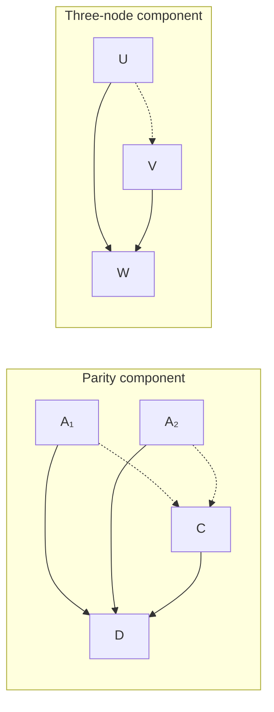

# Edge complementarity defeats greedy graph augmentation

The cost saved by adding edges to a fixed graph-bicausal transport problem is monotone but need not have diminishing returns. In a four-node example, two edges save 0.125 together and zero individually. A seven-node construction makes greedy choose a uniquely best first edge and achieve an arbitrarily small fraction of the optimal savings, even when it fills its budget and may consider every forward edge.

## Objective

Fix a topological order, two probability laws compatible with a base DAG $G$, and a cost $c(x,y)$ that stays fixed across graphs. Write $V(H)$ for the minimum graph-bicausal transport cost on $H$. For a set of forward edges $S$ absent from $G$, define the savings $F(S)=V(G)-V(G+S)$.

For a law that factors over $G$, its conditional law at a node given all earlier variables already depends only on its original parents. Conditioning on any enlarged parent set gives the same conditional law on positive-probability contexts. A paired kernel admissible on $G$ can therefore ignore the added parents and remain admissible. This proves that $F$ is monotone. The paired-kernel characterization comes from Proposition 4.7. [Obłój and Tuchilus](https://arxiv.org/html/2608.13716v1#S4.Thmtheorem7)

## A counterexample to submodularity

Let $a$ be $A\to C$ and $b$ be $B\to C$ in the four-node dependency-strength study at strength 0.75. The original cost and both single-edge costs are 0.375. Adding both edges gives cost 0.25. Hence

$$
F(\{b\})-F(\varnothing)=0
\quad < \quad
F(\{a,b\})-F(\{a\})=\tfrac18 .
$$

Submodularity requires the reverse inequality. The marginal benefit of $b$ rises after adding $a$. A greedy search that requires an immediate improvement stops at the base graph. If its only candidates are $a$ and $b$ and it must spend both slots, it succeeds, so this example alone does not establish a fixed-budget failure. [Four-node derivation and independent solver checks](../dependency_strength/README.md)

## A family with many complementary edges

Take $m\ge 2$ fair independent bits $A_1,\ldots,A_m$ and an independent fair bit $C$ in each law. All $m+1$ nodes point to $D$ in the base graph. In the source, $D=C\oplus A_1\oplus\cdots\oplus A_m\oplus E$. In the target, $D=C\oplus E$. The noise $E$ is independent within each law and has probability $(1-s)/2$ of being 1. Let $s\in(0,1]$. Use coordinate mismatch costs of 1 except at $C$, where the weight is $w$ with $0<w<s$. Take the order $A_1,\ldots,A_m,C,D$.

If some $A_i$ is outside the ancestors of $C$ in an augmented graph, its source bit is independent of the other source $A$ bits and the paired value at $C$. To see this, generate each pair in order using its paired kernel. For an $A_i$ pair, draw the source bit as a fresh independent fair bit, then draw the target bit conditional on it and the paired parents. The paired value at $C$ uses the draws at $C$ and its ancestors. The fresh source bit outside that set cannot enter its construction. Thus the source parity $P=X_{A_1}\oplus\cdots\oplus X_{A_m}$ stays fair conditional on the $C$ pair.

Given paired parents at $D$, its two conditional laws differ by $s$ in total variation when their intended bits differ and coincide otherwise. The intended bits differ when $P\oplus X_C\oplus Y_C=1$. If a source bit is outside the ancestors of $C$, this event has probability $1/2$. The cost is then at least $s/2$, attained by matching $A_1,\ldots,A_m,C$ and maximally coupling $D$.

To make all $m$ roots ancestors of $C$ requires at least $m$ added edges before $D$, since each root needs an outgoing edge on a path to $C$. Adding all $m$ direct edges $A_i\to C$ attains cost $w/2$. Match the $A$ bits, flip $C$ when $P=1$, and match $D$. This is optimal even with extra edges. When $P=1$, matching $C$ forces at least $s$ expected cost at $D$, and flipping $C$ costs $w$. Since $P=1$ half the time, the expected cost is at least $w/2$.

It follows that all proper subsets of the $m$ direct edges save zero. The complete set saves $\Delta=(s-w)/2$. This gives plateau examples from four to eight nodes by taking $m=2,\ldots,6$.

## Fixed-budget greedy can be arbitrarily bad

Append three nodes $U,V,W$ after $D$, independently of the parity variables within each input law. Start with $U,V\to W$. The roots $U,V$ are independent fair bits in each law. Set $X_W=X_U\oplus X_V$ and $Y_W=Y_V$. A mismatch costs $\lambda$ at $U$ or $V$ and $2\lambda$ at $W$, where $0<\lambda<s-w$.

The seven-node case uses the direct additions shown with dashed arrows.



Without an added edge in this component, the paired roots are independent. Consequently $X_U$ is fair given the $V$ pair and the two $W$ bits differ with probability $1/2$. Matching the roots attains cost $\lambda$. Adding $U\to V$ allows the $V$ pair to flip when $X_U=1$, matching $W$ and paying $\lambda/2$ at $V$. No coupling can beat $\lambda/2$ on these three coordinates. The XOR of the three bits is always zero in the source and fair in the target, so at least half the mass crosses parity classes at cost at least $\lambda$ per crossing. [Three-node collider fixture](../../examples/binary_collider.json)

The unique improving first edge is $U\to V$, even with every forward edge available. One edge cannot improve the parity component because $m\ge2$. A single edge from the parity component into $W$ leaves the deterministic laws at $W$ as before. A single edge into either $U$ or $V$ can condition only that pair on earlier parity nodes. The other pair remains an independent root, so the two pairs are still independent and the $W$ cost cannot improve. The only absent edge within the three-node component is $U\to V$.

With budget $m$, greedy spends one edge on $U\to V$. It cannot make all $m$ original roots ancestors of $C$ with the remaining slots, and the three-node projection already attains its ordinary transport lower bound. Its savings are $\lambda/2$ regardless of later tie-breaking. Spending all $m$ edges on the direct edges into $C$ yields $\Delta$. This is optimal. Any graph that improves the parity block must spend all $m$ edges within it, leaving the three-node block untouched. The savings ratio is therefore $\lambda/(s-w)$, which can approach zero on seven nodes by taking $m=2$ and shrinking $\lambda$.

| Nodes | Edge budget | Three-node weight $\lambda$ | Greedy savings | Optimal savings | Fraction of optimal savings |
|---:|---:|---:|---:|---:|---:|
| 7 | 2 | 0.0625 | 0.03125 | 0.125 | 25% |
| 7 | 2 | 0.015625 | 0.0078125 | 0.125 | 6.25% |
| 8 | 3 | 0.0625 | 0.03125 | 0.125 | 25% |
| 8 | 3 | 0.015625 | 0.0078125 | 0.125 | 6.25% |

These rows use $s=0.75$ and $w=0.5$. The script runs greedy and exhaustive search on the direct parity edges and $U\to V$ using their exact savings. The argument above establishes the same optimal savings and greedy ratio when all forward edges are available.

## Sensitivity to estimated probabilities

In the shared-noise model, the parity savings are $(s-w)_+/2$. An error of $\delta$ in the fitted $s$ changes these savings by at most $\delta/2$. The fit ranks the full parity set above $U\to V$ exactly when $\widehat s>w+\lambda$. For a true $s$ above that threshold, errors smaller than $s-w-\lambda$ preserve the ranking.

With $N$ independent observations per law, the pooled flip count is $B\sim\operatorname{Binomial}(2N,(1-s)/2)$ and the fitted strength is $\max(0,1-B/N)$. The table computes the binomial probability of $B<N(1-w-\lambda)$ for $s=0.55$, $w=0.5$, and $\lambda=1/32$. This measures whether the fitted objective gives the correct ranking in this particular model.

| Observations per law | Probability the fit strictly prefers the parity set |
|---:|---:|
| 64 | 56.64% |
| 256 | 67.82% |
| 1,024 | 83.88% |

## Evaluation counts and reproduction

With $r$ candidate edges and budget $k$, exhaustive search over size-$k$ sets considers $\binom rk$ graphs. Forward greedy scores $\sum_{j=0}^{k-1}(r-j)$ candidates along its path, apart from the baseline. The seven-node and eight-node examples have 16 and 22 absent forward edges, giving 120 and 1,540 size-budget subsets. Their dense coupling matrices would have 16,384 and 65,536 cells. These are problem sizes. The larger examples use analytic costs and the general GraphWeft solver supports up to four binary nodes.

Run from the repository root with Python 3.10 or newer. The test extra supplies SciPy for the binomial calculation and independent optimizer.

```sh
python -m pip install '.[test]'
python -m studies.edge_complementarity.run
python -m unittest discover -s tests -p test_reference_transport.py -v
```

## Relation to prior work

The usual cardinality-constrained greedy guarantee assumes submodularity. Here the individual contributions at the empty set sum to zero while the parity set has positive savings, so the corresponding submodularity-ratio bound is also zero. Supermodular degree is a related way to account for complementarity and motivates studying lookahead or allowing groups of edges. This note establishes the counterexample for the fixed-law graph-bicausal savings objective. Its priority in the transport literature remains to be determined. [Nemhauser, Wolsey and Fisher](https://doi.org/10.1007/BF01588971) · [Das and Kempe](https://jmlr.org/papers/v19/16-534.html) · [Feldman and Izsak](https://arxiv.org/abs/1407.6328)
